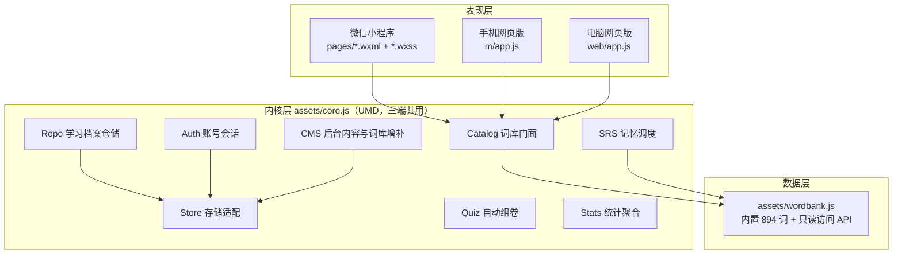
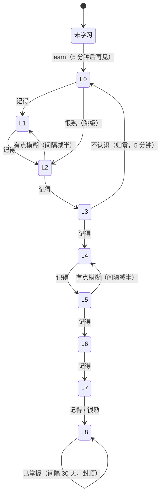
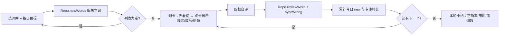

# 基于微信小程序的英语单词记忆学习系统 · 设计说明

> 人工智能专业 本科毕业设计　|　系统名称：忆单词 WordMemo　|　版本：v1.0.0（2026-11-18）

---

## 一、系统概述

### 1.1 设计目标

背单词类工具的核心问题不是「记不住」，而是**复习时机全靠猜**。本系统把认知心理学中的艾宾浩斯间隔重复（Spaced Repetition）落到一个可以直接运行、可以直接演示的完整工程里，实现四件事：

1. **按记忆规律调度复习**：每个词单独维护记忆档位与到期时间，到期的词自动排队，不靠用户自己规划。
2. **错题闭环**：答错或自评模糊的词自动进错词本，连续两次答对再自动移出，形成「错 → 攻克 → 出本」。
3. **可量化的学习结果**：正确率、保持率、九级分布、连续打卡、专注时长，都能在看板上直接读出来。
4. **多端一致**：一套内核同时驱动微信小程序、手机网页、电脑网页三个客户端，功能口径完全一致。

### 1.2 约束与取舍

| 约束 | 取舍 |
| --- | --- |
| 静态页面托管，无服务器 | 鉴权、存储全部放到浏览器/小程序本地，密码只做不可读化处理，不做真实安全承诺 |
| 答辩现场要能离线演示 | 零构建：不使用 npm / 打包器 / 框架，双击 HTML 即可运行，词库内置在 JS 里 |
| 要同时展示小程序端 | 小程序源码单独成工程，网页端用同一份内核代码复刻小程序界面，避免两端逻辑漂移 |
| 没有真机也能验证 | 为小程序页面脚本编写了 Node 桩化自检脚本（详见第八章） |

### 1.3 交付形态

| 客户端 | 目录 | 入口 | 用途 |
| --- | --- | --- | --- |
| 微信小程序 | `miniprogram/` | 微信开发者工具导入 | 毕业设计题目要求的移动端本体，可编译、可真机预览 |
| 手机网页版 | `m/` | `m/index.html` | 按小程序的导航栏/标签栏/卡片交互复刻的 H5，手机浏览器直接访问 |
| 电脑网页版 | `web/` | `web/index.html` | 侧栏 + 看板布局，适合答辩投屏与管理后台演示 |
| 站点首页 | `index.html` | 仓库根 | 三端入口、算法说明、进入方式（注册 / 登录 / 游客）、部署说明 |
| 自检脚本 | `tools/selfcheck.js` | `node tools/selfcheck.js` | 桩化小程序运行时逐页面驱动，95 项断言，输出写入 `tools/selfcheck-output.txt` |

---

## 二、总体架构

### 2.1 分层



设计要点：

- **表现层不写业务判断**。三端各自只做「取数 → 拼界面 → 回传事件」，同一个动作（例如自评「记得」）在三端都只调用 `Repo.reviewWord(profile, wordId, SRS.GRADE.KNOWN)`。
- **内核层用 UMD 导出**，浏览器里挂到 `window.WordMemoCore`，小程序与 Node 里走 `module.exports`，因此一份代码不需要任何改动就能被三个运行时加载。
- **数据层只读**。内置词库不允许被页面直接修改；后台新增的词写进 CMS，由 `Catalog` 在读取时合并，保证原始数据可复位。

### 2.2 模块职责

| 模块 | 对外接口（节选） | 职责 |
| --- | --- | --- |
| `Store` | `get/set/remove/eachKey/backend` | 探测运行环境，依次选择 `wx.setStorageSync` → `localStorage` → 内存对象 |
| `SRS` | `create/review/learn/isDue/untilDue/strength/stageName`、`INTERVALS`、`GRADE` | 记忆状态与间隔计算，唯一持有艾宾浩斯参数 |
| `Auth` | `login/register/guest/logout/session/isAdmin/users/findByAccount/resetPwd/setStatus/update`、`adminAccount/adminReady/setAdminPwd` | 账号体系（普通使用者自行注册、管理员口令由本人设定）、会话、口令哈希、角色 |
| `Repo` | `load/save/track/addMinutes/learnWord/reviewWord/syncWrong/toggleFav/dueQueue/newWords/today` | 学习档案读写、每日日志、待复习队列、错词本进出 |
| `Quiz` | `TYPES/build/check/shuffle/pick/distractors` | 四种题型的组卷、干扰项抽取、答案判定 |
| `Stats` | `streak/series/retention/accuracy/mastery/heatmap` | 打卡、近 N 天曲线、保持率、正确率、掌握分布、热力图 |
| `CMS` | `data/addWords/customWords/removeWord/editWord/setNotice/resetAll` | 后台增补词条与公告，独立于内置词库持久化 |
| `Catalog` | `init/banks/bank/words/all/find/search` | 词库门面：内置词 + 后台词合并、检索 |

---

## 三、数据模型

### 3.1 内置词条（`assets/wordbank.js`）

词库以紧凑四元组书写，加载时规范化为对象，避免数据文件里重复字段名：

```js
// 源数据：[单词, 音标, 词性与中文释义, 英文例句]
['abandon', '/əˈbændən/', 'v. 放弃；抛弃 n. 放纵', 'He had to abandon the experiment ...']

// 规范化后
{ id: 'gk-1', bank: 'gk', word: 'abandon', phonetic: '/əˈbændən/',
  meaning: 'v. 放弃；抛弃 n. 放纵', example: 'He had to abandon ...' }
```

| 词库 | id | 词数 | 定位 |
| --- | --- | --- | --- |
| 高考核心 | `gk` | 332 | 零基础重启、初高中衔接 |
| 四级高频 | `cet4` | 364 | 默认词库，CET-4 高频 |
| 六级进阶 | `cet6` | 198 | CET-6 补充词汇 |
| 合计 | — | **894** | 词条 id 形如 `cet4-1`，后台新增词形如 `x_<ts><rand>_<i>` |

### 3.2 记忆状态（`SRS.create`）

```js
{ id, level, reps, lapses, correct, wrong, learned, createdAt, lastAt, dueAt }
```

`level` 为 0–8 的记忆档位，`dueAt` 是下次到期的毫秒时间戳，`lapses` 记录「忘了几次」并参与记忆强度扣分。

### 3.3 学习档案（`Repo.load(bucket)`）

```js
{
  words:  { 'cet4-1': { ...记忆状态 }, ... },          // 每词一条
  log:    { '2026-11-18': { new, review, quiz, minutes } }, // 按天聚合
  wrong:  [ { id, n, last, cleared } ],                // 错词本
  fav:    [ 'cet4-9' ],                                // 收藏
  settings: { dailyGoal: 20, bank: 'cet4' },
  updatedAt: 1795000000000
}
```

### 3.4 存储键位

| 键 | 内容 | 写入者 |
| --- | --- | --- |
| `wm_users` | 账号列表（只内置一个口令留空的 `admin` 骨架，其余均为自行注册） | `Auth.saveUsers` |
| `wm_seed_ver` | 本机账号数据结构版本，低于当前版本时执行升级 | `Auth.users` |
| `wm_session` | 当前登录身份 | `Auth.setSession` |
| `wm_cms` | 后台增补词条 + 公告 | `CMS.save` |
| `wm_profile_<uid>` | 该账号的学习档案（游客为 `wm_profile_guest`） | `Repo.save` |

按账号分桶，所以同一个浏览器里管理员与普通用户的进度互不覆盖；`CMS.resetAll()` 会删除 `wm_profile_*` 前缀的全部键位实现一键复位。

### 3.5 账号与会话

| 字段 | 说明 |
| --- | --- |
| `uid` | `u_admin` 内置（口令为空，等本人设定），注册生成 `u_<时间戳><随机>`，游客固定 `guest` |
| `role` | `admin` / `user` / `guest`，决定能否进入管理后台 |
| `pwd` | 以 `'wm$' + 明文` 为输入、初值 5381 的 djb2 滚动哈希（`h = h×33 + charCode`，按 31 位截断）后转十六进制；仅做不可读化处理，不具备真实安全性 |
| `status` | `1` 正常，`0` 已被管理员停用，登录时拦截 |
| `bucket` | 档案桶名，游客与正式账号走同一套读写代码 |

管理员口令不预置：内置 `admin` 的 `pwd` 为 `null`，`Auth.adminReady()` 据此把管理端入口切成「设定密码」态，本人输入两遍并经 `Auth.setAdminPwd()` 哈希写入后才进入管理后台；此后 `Auth.login()` 只比对哈希。普通使用者一律走 `Auth.register()` 自设账号密码，或用 `Auth.guest()` 免注册。`wm_seed_ver` 低于当前版本时执行 `migrateUsers()`：丢弃历史内置演示账号、重置管理员骨架，保留自行注册的账号。

---

## 四、艾宾浩斯间隔重复算法

### 4.1 间隔表

```js
INTERVALS = [5, 30, 720, 1440, 2880, 5760, 10080, 21600, 43200]   // 单位：分钟
GRADE     = { FORGOT: 0, FUZZY: 1, KNOWN: 2, MASTERED: 3 }         // 四档自评
```

档位 → 实际等待时间：5 分钟 → 30 分钟 → 12 小时 → 1 天 → 2 天 → 4 天 → 7 天 → 15 天 → 30 天。

### 4.2 状态转移规则（`SRS.review`）

| 自评 | 档位变化 | 下次间隔 | 其他 |
| --- | --- | --- | --- |
| `FORGOT` 不认识 | `level = 0` | `INTERVALS[0]` = 5 分钟 | `wrong++`、`lapses++` |
| `FUZZY` 有点模糊 | `level - 1`（不低于 0） | `INTERVALS[level] × 0.5` | `wrong++` |
| `KNOWN` 记得 | `level + 1`（封顶 8） | `INTERVALS[level]` | `correct++` |
| `MASTERED` 很熟 | `level + 2`（封顶 8） | `INTERVALS[level] × 1.3` | `correct++` |

所有分支都会 `reps++`、`lastAt = now`、`learned = true`，并把 `dueAt = t + 间隔`。首次学习走 `SRS.learn`，直接落到 0 档、5 分钟后再见。



### 4.3 记忆强度与掌握度

```js
strength = max(0, level / 8 × 100 − min(30, lapses × 6))   // 0–100，卡片进度条
retention = 已学词中 level ≥ 4 的占比                      // 统计口径「保持率」
mastery   = { fresh: 未学, weak: level ≤ 2, fair: 3 ≤ level ≤ 5, strong: level ≥ 6 }  // 四桶分布
```

### 4.4 一个词的完整时间线（示例）

| 时刻 | 动作 | 结果 |
| --- | --- | --- |
| 20:00 | 首次学习 `abandon` | level 0，`dueAt` 20:05 |
| 20:06 | 自评「记得」 | level 1，30 分钟后 → 20:36 |
| 20:40 | 自评「记得」 | level 2，12 小时后 → 次日 08:40 |
| 次日 08:45 | 自评「有点模糊」 | level 1，间隔减半 → 15 分钟后 |
| 次日 09:05 | 自评「不认识」 | level 0，5 分钟后；同时进错词本 |
| 第三日 | 连续两次「记得」 | 错词本 `cleared` 达到 2，自动移出 |

### 4.5 待复习队列

`Repo.dueQueue(profile, words, limit)` 扫描词表，筛选 `learned && dueAt <= now`，按 `dueAt` 升序（越紧急越靠前），`limit` 控制单轮数量；`newWords` 则按词库顺序取未学词，两者共同构成本轮学习列表。

---

## 五、功能模块与流程

### 5.1 登录入口（唯一）

一个页面三个 Tab：登录 / 注册 / 管理员。

- 「登录」用已注册账号进来；「注册」自己填账号与密码，校验账号 `^[a-zA-Z0-9_]{3,20}$`、密码 ≥ 6 位，注册成功即登录。
- 「管理员」Tab 不显示账号，只收密码。`Auth.adminReady()` 为假时多出一个「确认密码」输入框，按钮变成「设定密码并进入管理后台」，两遍一致才写库；为真时按普通密码校验。页面、注释与词库文件里都不存在管理员密码，答辩用机需在首次打开时现场设定。
- 「游客登录，先看看」写入 `guest` 会话，进度存在 `wm_profile_guest`，功能与注册用户一致，仅没有管理端。
- 账号被停用时返回「该账号已被管理员停用」，密码错误与账号不存在分开提示；普通用户在登录 Tab 输入管理员账号会被挡回并提示切换 Tab，管理端入口只在 `role === 'admin'` 时渲染。

### 5.2 学新词



### 5.3 复习

五个范围同一套卡片：**今日到期 / 全部已学 / 错词本 / 收藏 / 当前词库**。支持按单词与释义搜索、分页浏览、逐词发音、逐词收藏，点「开始复习」把范围转成本轮列表并跳到学习卡片。

### 5.4 测试（自动组卷）

`Quiz.build(items, pool, types)`：

| 题型 | id | 出题方式 | 判定 |
| --- | --- | --- | --- |
| 看词选义 | `meaning` | 题面为单词 + 音标，可播放发音，四选一释义 | 选中项下标 |
| 听音选词 | `listening` | 播放读音，四选一拼写 | 选中项下标 |
| 听音拼写 | `spelling` | 播放读音，按「首字母 + 下划线 + 尾字母」提示输入完整单词 | 忽略大小写与首尾空格的字符串比较 |
| 例句填空 | `example` | 例句中目标词替换为 `____`，四选一补回 | 选中项下标 |

题型按 `types[i % types.length]` 轮流分配，用户可在测试设置里关掉任意题型。干扰项由 `Quiz.distractors` 从调用方传入的词表（三端均为全部 894 词 + 后台增补词）随机抽 3 条，并排除与目标词同形的词；答对按 `KNOWN` 写回，答错按 `FORGOT` 写回并进错词本，结束后给出正确率、错题回顾与逐题解析。

### 5.5 错词本

`Repo.syncWrong` 是唯一入口：`FORGOT / FUZZY` 时入本或累加 `n` 并重置 `cleared`；`KNOWN / MASTERED` 时 `cleared++`，达到 2 就从数组里删除。因此错词本不需要用户手动清理。

### 5.6 统计

`Stats` 输出五组图形数据：连续打卡天数、近 14 天学习量柱图、40 天热力图、保持率与正确率、九级分布。管理端「概览」复用同一批接口做全站汇总。

### 5.7 管理后台

| 分区 | 能力 |
| --- | --- |
| 概览 | 用户数、全站已学词次、累计答题数、各词库容量 |
| 用户 | 列表（含每人已学量）、重置密码、停用/恢复；禁止停用当前登录账号 |
| 词库 | 单条新增（单词必填、释义必填）、批量 CSV/TSV 导入、删除自定义词、按词库筛选 |
| 系统 | 站点公告编辑、九级间隔表只读展示、运行环境（存储后端 / 词数 / 版本）、一键清空本机数据 |

CSV 解析规则：兼容英文逗号、中文逗号与制表符，支持双引号包裹字段（含转义 `""`）；跳过空行与表头行（首列为 `word` / `单词`）；**单词与释义缺一即丢弃**，重复词按 `词库|小写单词` 去重，导入结果以「导入 N 词，跳过 M 词」回显。

---

## 六、三端实现说明

### 6.1 微信小程序 `miniprogram/`

| 文件 | 说明 |
| --- | --- |
| `app.json` | 8 个页面注册、绿色导航栏、底部 5 个标签（首页/学习/复习/测试/我的） |
| `app.js` | 全局：注入内核、会话刷新 `refresh()`、`save()`、`isAdmin()`、`ensureLogin()`、发音 `speak()`、词库助手 `bankWords/bankName/dueText` |
| `app.wxss` | 全局样式：卡片、单元格、KPI、分段控件、翻卡、自评按钮、选项、表格、热力图等 |
| `pages/login` | 唯一登录入口（登录/注册/管理员三 Tab + 游客进入） |
| `pages/home` | 今日目标环形进度、五项 KPI、近 7 天柱图、词库切换、快捷入口 |
| `pages/study` | 学习设置 + 翻卡 + 自评 + 本轮小结（`session` 由 `globalData` 承载，复习页也能复用） |
| `pages/review` | 五范围切换、搜索、分页、发音、收藏、发起复习 |
| `pages/quiz` | 组卷范围/题量/题型选择 → 逐题作答 → 成绩与错题回顾 |
| `pages/mine` | 资料、每日目标、默认词库、修改密码、管理入口、退出、关于 |
| `pages/stats` | 打卡、14 天柱图、热力图、保持率/正确率、九级分布、明细日志 |
| `pages/admin` | 概览 / 用户 / 词库 / 系统四 Tab，与网页版后台同能力 |
| `utils/core.js` | 与 `assets/core.js` 同一内核，仅 `Store.eachKey` 改为 `wx.getStorageInfoSync()` 遍历 |
| `utils/wordbank.js` | 与 `assets/wordbank.js` 完全一致的词库数据 |
| `project.config.json` | `appid: "touristappid"`、`urlCheck: false`（发音接口是第三方域名） |

小程序端两个特有实现：

- **复习 → 学习的路由**：`review.js` 构造 `app.globalData.session` 后 `wx.switchTab('/pages/study/study')`，由学习页统一渲染卡片，避免两处重复实现翻卡 UI。
- **发音**：`wx.createInnerAudioContext()` 播放 `https://dict.youdao.com/dictvoice?audio=<encodeURIComponent(word)>&type=1`，属于第三方域名，需要在开发者工具里关闭域名校验；两个网页端改用浏览器 `SpeechSynthesisUtterance`（`lang = 'en-US'`、`rate = 0.85`），不依赖任何外部接口，离线也能读。

### 6.2 手机网页版 `m/`

单页应用：`#navbar` + `#page` + `#tabbar` + `#modal/#sheet/#toast` 五个容器，页面由 `PAGES` 映射函数生成 HTML 字符串，事件用 `data-action` 委托到统一处理器；`S.stack` 维护返回栈，模拟小程序的页面栈与左上角返回。词法与小程序一致（自评四档、错词本、组卷、统计）。搜索框（`#bk-kw` / `#rv-kw`）输入 260 ms 后自动过滤重渲染，并把焦点与光标位置还回输入框。

### 6.3 电脑网页版 `web/`

侧栏分组导航（学习 / 内容 / 数据 / 系统）+ 主区路由 `route(name)`，共 10 个视图：`home / study / review / quiz / bank / wrong / fav / stats / profile / admin`。管理后台用表单 + 表格呈现，批量导入用文本域粘贴 CSV，词条详情用模态框，支持「先记一下」直接写入记忆状态。

---

## 七、关键实现细节

| 主题 | 做法 |
| --- | --- |
| 专注时长 | 翻卡或答题时计算与上一动作的时间差，`Repo.addMinutes(p, 差/60000)` 累加到当天日志，精度 0.1 分钟，避免频繁写盘 |
| 每日目标 | `settings.dailyGoal`，完成度 = 今日 `new` / 目标，首页环形进度与卡片头部复用 |
| 会话与档案 | 登录后 `Auth.session()` 给出桶名，`Repo.load(bucket)` 补齐缺失字段，旧数据不会因为新增字段而报错 |
| 游客与用户并存 | 桶名不同（`guest` / `<uid>`），切换身份即切换档案，不需要退出清理 |
| 数据兼容 | `Repo.load` 对 `words/log/wrong/fav/settings` 全部做默认值兜底；`Catalog.find` 识别 `x_` 前缀回落到 CMS |
| 搜索 | `Catalog.search(kw, bankId, limit)`：单词按小写包含匹配，中文释义按原文包含匹配。两个网页端输入 260 ms 后重渲染并回焦输入框（字符串模板整块替换节点，不恢复光标就没法连续输入）；小程序端在 `onKw` 里直接 `setData` 重渲染列表 |
| 复位 | `CMS.resetAll()` 删除账号表、会话、数据结构版本、CMS 与全部 `wm_profile_*`，下次读取自动回到只剩口令待设定的管理员骨架 |
| 无框架渲染 | 网页端字符串模板 + 事件委托；小程序端 `setData` + `wx:for`。长列表分页避免一次渲染过多节点：电脑端词库表 15 行/页、手机端 20 行/页、小程序复习列表 30 条/页 |

---

## 八、测试

### 8.1 测试环境

| 端 | 环境 | 方式 |
| --- | --- | --- |
| 电脑网页版 / 手机网页版 | Chrome（本机，含 `file://` 直开与 Pages 线上地址） | 真实浏览器手工操作 + 脚本注入断言 |
| 微信小程序 | Node 桩化运行时（`wx` / `App` / `Page` / `getApp`），命令 `node tools/selfcheck.js` | 自检脚本逐方法驱动，共 95 项断言，全部通过；输出同时写入 `tools/selfcheck-output.txt` |
| 内核算法 | 同上，页面脚本直接调用 | 与小程序页面同一批断言覆盖 |

> 说明：小程序端**未在微信开发者工具中真机运行过**（本机无该工具）。桩化运行时按小程序规范实现了 `wx.setStorageSync / getStorageSync / getStorageInfoSync / removeStorageSync / showToast / showModal / switchTab / reLaunch / navigateBack / createInnerAudioContext`，因此可验证页面脚本的可运行性与逻辑正确性；导入开发者工具后仍需按第六章步骤关闭域名校验并复测发音。

### 8.2 内核与小程序自检用例（95 项，全部通过）

| 组 | 代表断言 |
| --- | --- |
| 启动与登录 | 未登录 `reLaunch` 到登录页；种子账号只剩一个 `pwd` 为空的管理员骨架，`admin / admin123` 这类旧口令返回 `needSet`；管理员密码短于 6 位、两次不一致均被拒；`setAdminPwd` 成功后 `adminReady()` 为真、错密码登录失败、正确密码登录成功；自行注册 `learner` 后 `refresh()` 返回 `true` |
| 首页 | 默认词库名「四级高频」、新词数 364、近 7 天柱图 7 项、总词数 894、切换高考词库后新词 332 |
| 学新词 | 设置页词库 chips = 3；卡片首词 `aboard`；翻卡成功；例句高亮切成 `[{t,hl}]` 片段；收藏写入 1 条；20 词自评后进入小结、正确率在 0–100 |
| 数据写入 | 今日 `new = 20`；专注时长 > 0（可控时钟模拟每次停留 20 秒 → 记 6 分钟）；错词本按 `FORGOT/FUZZY` 累计 10 条；退出清空本轮会话 |
| 复习 | 五个范围计数正确（到期/已学/错词/收藏/词库）；搜索 `zzzz` 过滤到 0 条；错词本发起复习并跳转学习页；切换词库写入全局 `bank` |
| 测试 | 五种范围计数；关闭「听音拼写」后题型集生效；逐题作答直至出结果；`today.quiz > 0`；错题回顾为数组 |
| 我的 | 昵称、角色、档案桶名；每日目标写入 30；默认词库切换；修改密码后能用新密码登录 |
| 统计 | 14 天柱图、40 天热力图、9 级分布、日志 ≥ 1、已学 > 0、时长 > 0、四桶分布 |
| 管理后台 | 概览用户数、三词库计数 `[332,364,198]`、用户列表、重置密码回显、停用状态写入且禁止停用当前账号、单条新增词条、目录从 894 → 895、CSV 导入「1 词入库 / 非法行跳过」、删除词条回到 894、九级间隔表 9 行、系统信息含存储后端与词数、公告保存 |
| 会话与持久化 | 退出后回到登录页；登录页 `acc` / `pwd` 为空、不预填任何口令；管理员 Tab 错密码被提示「密码不正确」；页面注册新账号并登录；游客进入且游客桶可读；存储后端为 `wx.setStorageSync`；档案与账号在写入后可重新读出；同毫秒注册的 `uid` 不重复；复位后只剩口令未设定的管理员骨架；喂入旧版本本机数据（含 `student` 与带预置口令的 `admin`）时演示账号被丢弃、管理员口令清空、自行注册的账号保留 |
| 算法回归 | `SRS.learn` 写出的 `dueAt / lastAt` 必须是数值（防止被误当函数引用拼接成字符串）；`untilDue` 输出「N 分钟后」 |

### 8.3 网页端用例（Chrome 实测，全部通过）

| 编号 | 端 | 步骤 | 实测结果 |
| --- | --- | --- | --- |
| W-01 | `web/` | 清空本机后打开 `web/index.html`，切到管理员 Tab | 不显示账号框、密码框为空，多出「确认密码」；两次不一致提示「两次输入的密码不一致」且不写会话，一致后进入管理后台 |
| W-02 | `web/` | 游客进入后学 20 个新词 | 今日进度 +20，卡片显示「5 分钟后」到期 |
| W-03 | `web/` | 自评「不认识」 | 词进错词本，档位归零 |
| W-04 | `web/` | 复习页搜索中文释义 | 输入 260 ms 后列表实时过滤并分页，焦点仍在搜索框 |
| W-05 | `web/` | 测试选 10 题、只勾看词选义与例句填空 | 结果页题量 10，题型集合符合选择 |
| W-06 | `web/` | 管理员密码登录 → 词库 → 粘贴含表头与空释义的 CSV | 表头与非法行被跳过，提示「导入 N 条，跳过 M 条」 |
| W-07 | `web/` | 「注册」填 `zhou2026 / 自定密码` 进入，退出后改用「登录」Tab 登录同一账号 | 注册即登录；再次登录成功且每日目标 12 仍在；游客与普通用户共用一个入口 |
| W-08 | `web/` | 管理后台 → 系统 → 清空本机数据（confirm 确认） | 页面回到登录页，`wm_users` 只剩 `admin/unset`，`adminReady()` 为假，原密码登录被拒 |
| W-09 | `web/` | 同一浏览器分别用管理员与注册用户保存设置 | 两份档案互不覆盖（`wm_profile_u_admin` 目标 40 / `wm_profile_u_<注册uid>` 目标 12） |
| W-11 | `web/` | 检查登录页可见文本与 `localStorage`；在「登录」Tab 输入管理员账号 | 页面上没有 `admin123` / `123456`，存储里只有哈希；管理员账号被提示「请切换到管理员标签登录」并清除会话；不存在的账号提示「账号不存在，可先注册」 |
| M-01 | `m/` | 自注册账号登录 → 学习 → 开始学新词 | 五个底部标签可切换，翻卡后四档自评按 60 ms 连点 4 次，`today.new = 4`、档位全为 1（改版后自检脚本用自注册账号复跑 20 词路径 `tracked 20 new` 通过） |
| M-02 | `m/` | 自评「有点模糊」 | 档位回到 0、间隔减半，错词本 +1 |
| M-03 | `m/` | 卡片停留 7 秒后自评 | 当天专注时长由 0 增至 0.4 分钟（累计此前每次翻卡的停留，精度 0.1 分钟） |
| M-04 | `m/` | 测试页选默认范围出 10 题，混合作答 | 选择题 7 题 + 听音拼写 3 题，结果页统计用时并列出错题回顾，`today.quiz = 10` |
| M-05 | `m/` | 我的 → 学习统计 | 14 天柱图、热力图、九级分布正常渲染 |
| M-06 | `m/` | 我的 → 个人设置 → 修改密码 → 退出后用旧、新密码分别登录 | 提示「密码已更新」；旧密码被拒（会话仍为 `null`），新密码进入且侧栏出现管理端入口 |
| M-07 | `m/` | 后台四个 Tab：概览 / 用户 / 词库 / 系统 | 用户列表含管理员与注册用户；新增 `meticulous` 后目录 894→895，删除后回 894；系统页九级间隔表 9 行、显示存储后端与词库版本 |
| M-08 | `m/` | 后台发布新公告 | 首页公告条同步显示新内容 |
| M-09 | `m/` | 词库浏览输入 `aboa`、`效率` | 分别过滤到 `aboard` 与 `efficient`，输入框焦点与已输入内容保留 |
| M-10 | `m/` | 普通用户登录后看「我的」；游客登录后再查 | 普通用户与游客都不出现管理端入口；`localStorage` 全量文本中不含任何明文口令 |
| W-10 | `m/` | 手机访问 `m/index.html` | 全出血布局、底部标签栏可切换五个页面；桌面浏览器套手机壳预览 |

---

## 九、部署与运行

```bash
# 本地（无需依赖）
git clone <仓库地址>
# 双击 word-memo-miniprogram/web/index.html 或 m/index.html

# 小程序端逻辑自检（需要 Node，仅用于测试，不是运行依赖）
node tools/selfcheck.js     # 打印 95 项断言，同时写入 tools/selfcheck-output.txt

# GitHub Pages
仓库 Settings → Pages → Source: Deploy from a branch → main / (root) → Save
访问 https://<用户名>.github.io/<仓库名>/
```

- 站点根目录即 `index.html`（首页），`web/`、`m/` 为两个可直接访问的网页端；仓库已放置 `.nojekyll`，避免目录被 Jekyll 处理。
- 小程序端不参与 Pages 部署，用微信开发者工具导入 `miniprogram/`（AppID 选测试号，本地设置取消「校验请求域名」）。
- 全部数据存于本机，换设备不同步；演示前可在管理后台「系统 → 清空本机数据」复位。

---

## 十、局限与改进方向

| 局限 | 原因 | 可演进方向 |
| --- | --- | --- |
| 管理员口令只在本机生效 | 纯静态、无服务端：口令只以哈希存在本机 `wm_users`，页面与代码不含默认口令，但换设备或清缓存后要重新设定，持有设备的人也能为自己的浏览器设定一个管理端口令 | 接入微信登录 + 云开发/自建 API，口令换 bcrypt/JWT，管理员身份由服务端校验 |
| 进度不跨设备同步 | 数据只在本机 | 用小程序云数据库按 `openid` 存档案 |
| 词库固定 894 词 | 内置静态数据 | 后台上传词表 → 生成新词库；或接入词典 API 补全释义与例句 |
| 自评为主观判断 | 未采集作答耗时与犹豫度 | 把作答时长、错误次数纳入 `SRS` 权重，做自适应间隔 |
| 未做真人语音与拼写校验 | 仅 TTS + 字符串比较 | 引入 `wx.getRecorderManager` 与语音评测 API |
| 小程序未真机复测 | 本机无微信开发者工具 | 按 6.1 的导入步骤编译运行，回归发音与标签栏交互 |
